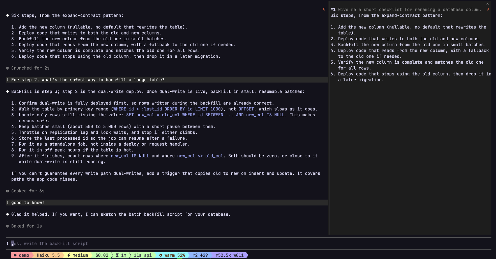

# pin-it

A Claude Code mod that pins Claude's replies to a side pane, so steps or info you need stay in view while the conversation moves on.



It runs in the terminal and in the Claude desktop app.

## Use

- Hover a reply and click the **⚲** at its top right to pin it; click again to unpin. A reply that uses tools is drawn in parts, and each part has its own ⚲. Pinned parts keep their ⚲ showing.
- `/pin` pins Claude's whole last reply, every part of it around tool calls; parts of it you pinned from the chat merge into that one pin. Clicking the ⚲ on any of its parts unpins the whole reply.
- `/unpin N` removes pin #N, `/unpin` alone removes the last pin, and `/unpin all` clears them; in the pane, click a pin's **⚲** to unpin it.
- `/pins` reopens the Pinned pane.
- Each pin in the pane is headed by the first line of the prompt it answered.

Pins are saved, so they come back when you restart Claude Code. Each pin is cleared 7 days after you pinned it, unless you set **keep pins** to `forever` (see [Configure](#configure)). Expired pins are cleared when a session starts and whenever you pin or unpin.

Pins are kept per folder you start Claude in, so a subfolder or a git worktree of a project has its own list; this includes worktrees the desktop app makes for its sessions.

Open sessions started in the same folder share pins. An open session picks up a pin saved elsewhere when you send a prompt, when Claude finishes a turn, or when you run `/pins`.

### Limits

- The pane draws pins with the app's generic markdown, so styling (e.g. inline-code color) differs slightly from the chat.
- The desktop app draws the ⚲ grey; the terminal draws it orange.

## Configure

Set these in `/config`. They're stored in `~/.claude/settings.json`, so the desktop app follows them too.

| Setting | Options | Default | What it does |
|---|---|---|---|
| **Pin it: keep pins** | `7 days`, `forever` | `7 days` | How long saved pins are kept. `forever` keeps them until you unpin them. |
| **Pin it: sync pins** | `on activity`, `every 5 seconds` | `on activity` | When an open session picks up pins another session saved in the same folder. `every 5 seconds` also checks on a timer. |

## Privacy

Pinned replies are stored locally, in `~/.claude/plugins/store/`, along with the first line of the prompt each one answered. pin-it makes no network requests, runs no processes, and doesn't change or block anything Claude does. `/unpin all` deletes a folder's saved pins.

## Install

Requires Claude Code 2.1.295 or later.

Inside a Claude Code session (run `claude` first; this is a slash command, not a shell command):

```
/plugin install pin-it --marketplace notyourcpa/pin-it
```

Answer `y` to add the marketplace, then pick a scope.

Or from your shell:

```bash
claude plugin install pin-it --marketplace notyourcpa/pin-it
```

This adds the marketplace and installs for your user; pass `--scope project` or `--scope local` to install elsewhere.

## Troubleshooting

If the ⚲ or the Pinned pane doesn't appear:

1. Check that `claude --version` is 2.1.295 or later.
2. Run `/reload-plugins`.
3. Run `/pins` to reopen the pane.

## Develop

```bash
claude --plugin-dir path/to/pin-it
```

The folder is watched; saving a file reloads the mod.

```bash
claude plugin validate path/to/pin-it
claude plugin test path/to/pin-it
```

Code: `hooks/register.tsx`. State types: `types/index.d.ts`. Tests: `pin.test.ts`.

## License

MIT. See [LICENSE](LICENSE).
